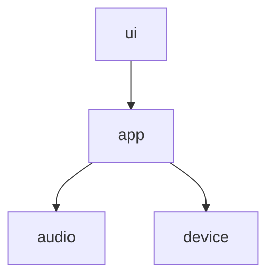

# 全体の構成

## フォルダ構成

```
main/
├── ui/                 画面
├── app/                アプリ
├── audio/              音
├── device/             ハードウェア入出力
├── util/               共通処理
├── pocket-deck.cpp     app_main
├── startup.hpp         起動
└── task_config.hpp     タスク優先度・コア・スタック設定
```

## 階層構造



| 名称 | 役割 |
|----|------|
| ui | 画面 |
| app | 曲と再生の管理 |
| audio | 音 |
| device | ハードウェア入出力 |

## ファイルの役割

### ui

| ファイル | 役割 |
|----------|------|
| `ui.hpp` | 画面起動 |
| `lvgl_port.hpp` | LVGL初期化と実行 |
| `screens/file_list.hpp` | 曲一覧 |
| `screens/now_playing.hpp` | 再生中画面 |
| `widgets/status_bar.hpp` | ステータスバー |
| `widgets/eq_view.hpp` | イコライザー表示 |
| `keys.hpp` | キー割り当て |

### app

| ファイル | 役割 |
|----------|------|
| `input.hpp` | キー入力変換 |
| `playlist.hpp` | 曲一覧 |
| `playback.hpp` | 再生制御 |

### audio

| ファイル | 役割 |
|----------|------|
| `speaker.hpp` | スピーカー起動 |
| `volume.hpp` | 音量 |
| `wav.hpp` | WAV解析 |
| `player.hpp` | 再生 |
| `spectrum.hpp` | イコライザー計算 |

### device

| ファイル | 役割 |
|----------|------|
| `display.hpp` | 画面出力 |
| `keyboard.hpp` | キー入力 |
| `sdcard.hpp` | SDカード |
| `battery.hpp` | 電池残量 |

## その他

| 名前 | 役割 |
|------|------|
| 起動（`pocket-deck.cpp`, `startup.hpp`） | 各部初期化 |
| `util/` | 共通処理 |
| `task_config.hpp` | タスク設定 |

## 状態の持ち主

| 状態 | 持ち主 | 読み書きするタスク |
|------|--------|--------------------|
| 曲一覧 | `playlist.hpp` | 起動時に書く |
| 再生状態・位置・リピート | `playback.hpp` | LVGL のタスクだけ |
| 再生実行 | `player.hpp` | 再生用と、LVGL のタスク |
| イコライザーレベル | `spectrum.hpp` | 計算用が書き、LVGL が読む |
| 音量 | `volume.hpp` | LVGL が読み書き。保存はタイマー |
