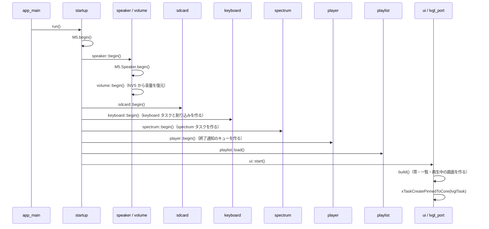
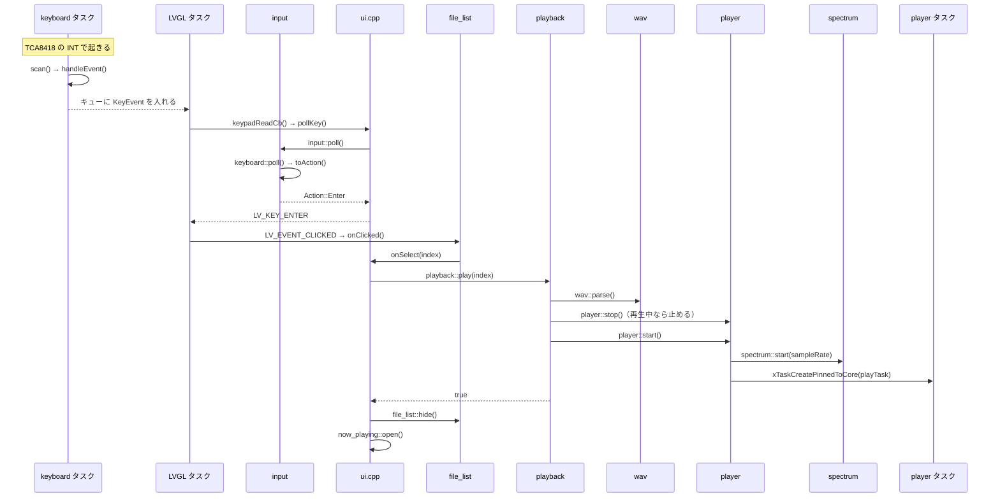
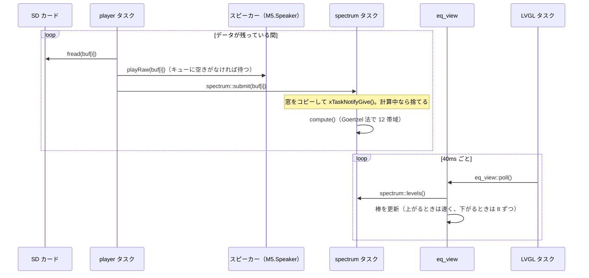
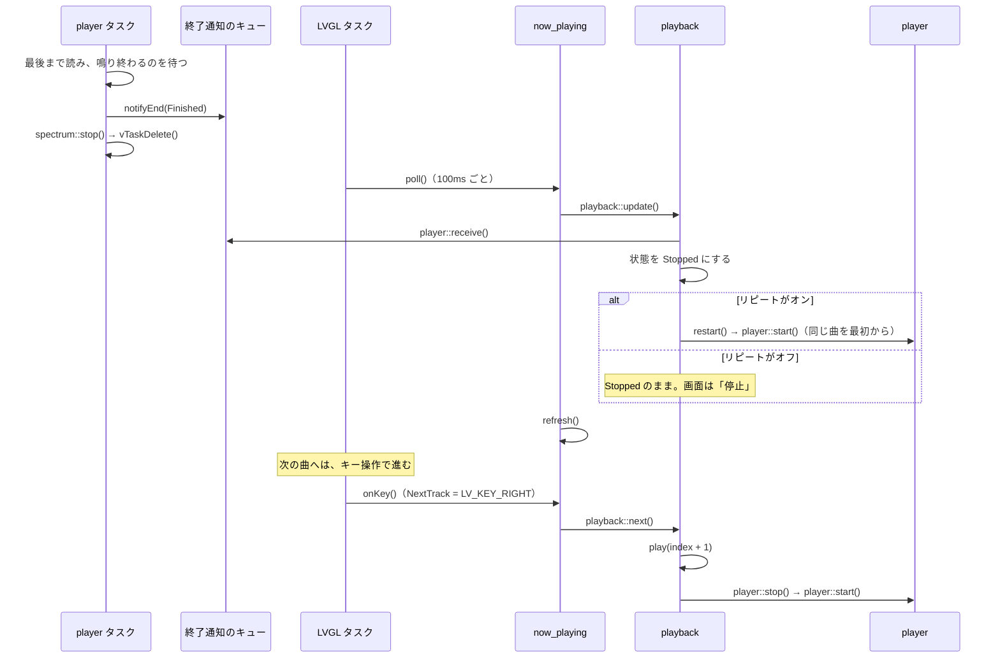
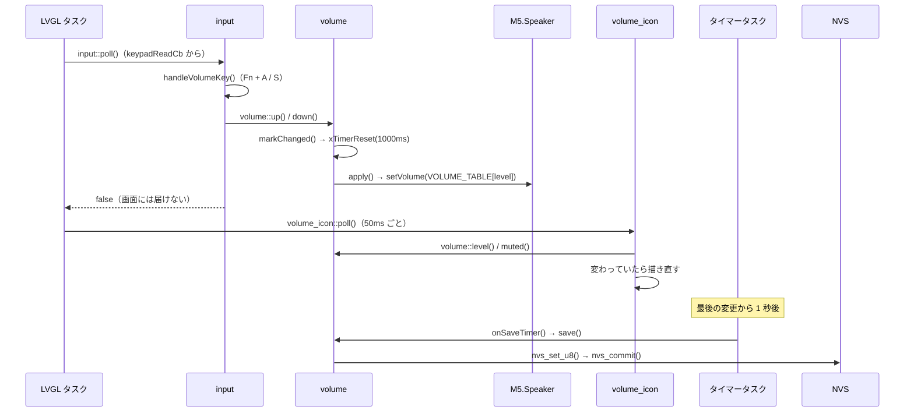

# 処理の流れ（シーケンス図）

主な処理の流れを、5 つの図で示す。登場者はタスクかモジュールで、矢印の名前はソースの関数名に合わせてある。細かい分岐（失敗時の処理など）は、図の下の説明に書く。タスクの一覧は [tasks.md](tasks.md)、モジュールの役割は [overview.md](overview.md) を見る。

## 1. 起動（初期化の順序）

- 順序には理由がある。SPI は `M5.begin()` の後（ディスプレイ用の SPI と衝突しないため）、音量はスピーカーの後、曲の一覧は SD カードの後、画面は keyboard / player のキューと曲の一覧ができた後。
- `sdcard::begin()` / `keyboard::begin()` / `player::begin()` / `ui::start()` が失敗したら、`startup::fail()` がログと画面（`ui::showError()`）に出して `run()` を終える。以降のタスクは起動しない。
- `spectrum::begin()` が失敗しても、棒が動かないだけなので警告を出して続ける。
- `playlist::load()` が失敗しても 0 件になるだけで、一覧に「(none)」が出る。

## 2. キー入力から再生の開始まで

- キーボードは「押された瞬間」だけをキューに入れる。`keypadReadCb()` は、1 件取れたら押下を返し、続けて離上を返す。
- `input::poll()` は音量のキー（Fn + A / S / D）をここで処理して `false` を返すので、図の流れには乗らない（5 を見る）。
- `wav::parse()` に失敗したとき（16bit PCM 以外など）は、ログに出して `false` を返す。今の再生は続け、画面も変わらない。
- `player::start()` に失敗したときは、状態を `Stopped` にして `false` を返す。
- 再生が始まったら、`now_playing::open()` が再生中の画面を出し、フォーカスを固定する（上下キーで、隠れた一覧の行に移らないため）。

## 3. 再生中の、音とイコライザーの流れ

- `playTask` はバッファ 3 個（`BUF_COUNT`）を順番に使う。`playRaw()` は渡したバッファを再生が終わるまで参照するため。
- `spectrum::submit()` は `playRaw()` が戻った後に呼ぶ。映像が音より先に動かないようにするため。
- イコライザーの内容は、音より最大でバッファ数個分（約 0.1 秒）先になる。
- 一時停止・停止・終了のどれでも、`playTask` の最後に `spectrum::stop()` を呼び、棒を 0 に戻す。

## 4. 曲の終了から次の曲まで

- 今の実装では、曲が終わっても自動で次の曲には進まない。リピートがオフなら `Stopped` になり、次の曲へはキー操作（→ または l）で進む。
- `Space`（`togglePause()`）は、`Stopped` のとき今の曲を最初から再生する。
- `next()` は一覧の最後、`prev()` は先頭では何もしない。
- ファイルが開けない・読めないときは `Failed` が届く。`update()` はこれも `Stopped` にするが、リピートの対象にはならない（`Finished` のときだけ）。
- 自分で止めた（曲の切り替え・一時停止・停止）ときに出た `Stopped` の通知は、`drainEvents()` で捨てる。終了と取り違えないため。

## 5. 音量の変更と保存

- 音量は 0〜16 の 17 段階で、`VOLUME_TABLE` で 0〜255 の `setVolume` の値に変える。下の段階ほど細かい。
- キーを連打しても、保存は最後の変更から 1 秒後に 1 回だけ。フラッシュの書き込み回数を減らすため。
- Fn + D（`toggleMute()`）は、`apply()` で音を 0 にするだけで、保存はしない。起動時は必ず消音を解除する。消音中に `up()` / `down()` をすると、消音を解除してから段階を変える。
- 段階の端（0 と 16）では、段階は変わらず、保存もしない。
- 起動時は `volume::begin()` が NVS から段階を読む。保存がない初回は `DEFAULT_LEVEL`（4）。NVS が使えないときは、保存せずに既定値で続ける。
