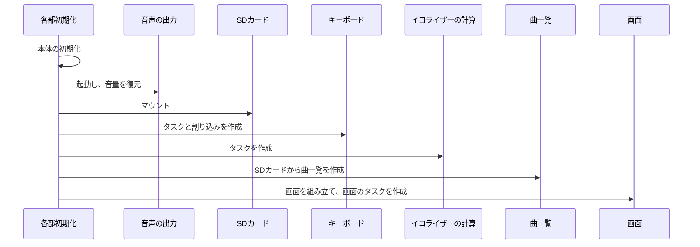
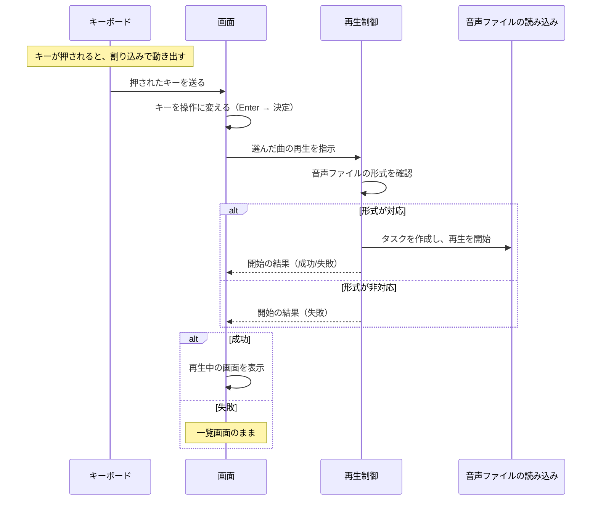
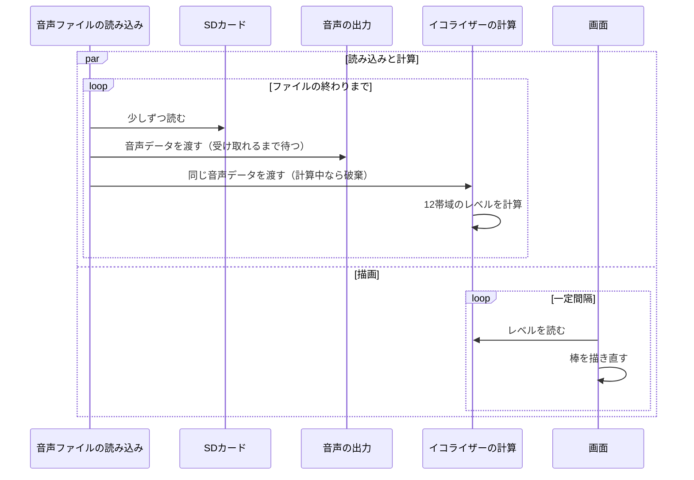
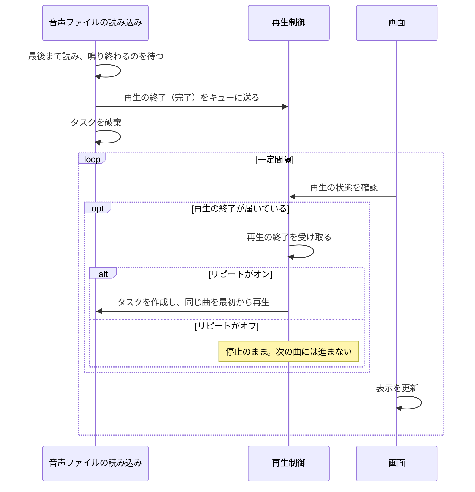
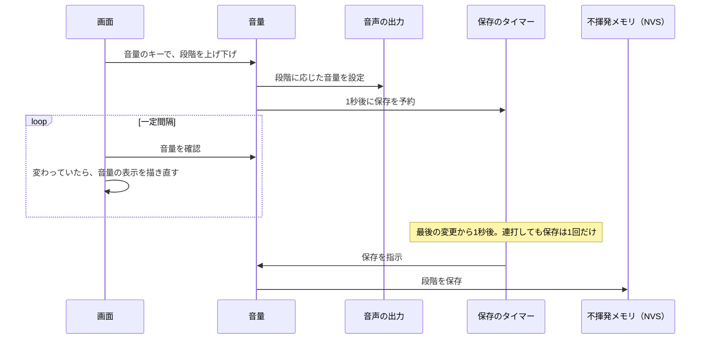

# 処理の流れ（シーケンス図）

主な処理の流れを、5つの図で示す。用語は、[tasks.md](tasks.md)と[overview.md](overview.md)を参照。

## 1. 起動

### 補足

| 処理 | 行うタイミング | 理由 |
|------|----------------|------|
| 曲一覧の作成 | SDカードのマウントの後 | 曲一覧はSDカードから読み込む |
| 画面の組み立て | 最後 | 画面はキー入力と曲一覧を使う |

## 2. 一覧から曲を選んで再生

## 3. 再生中の音声とイコライザー

## 4. 曲が終わったとき

## 5. 音量の変更

